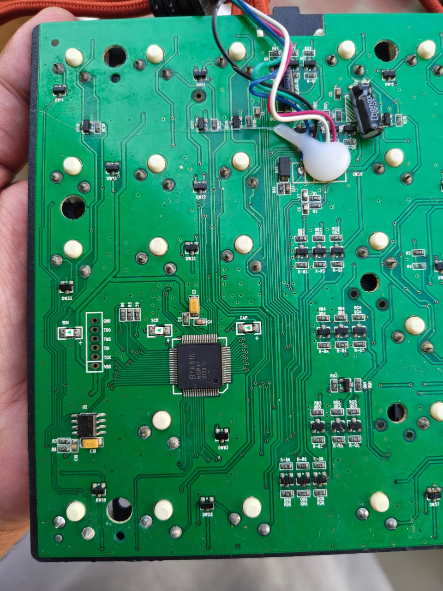
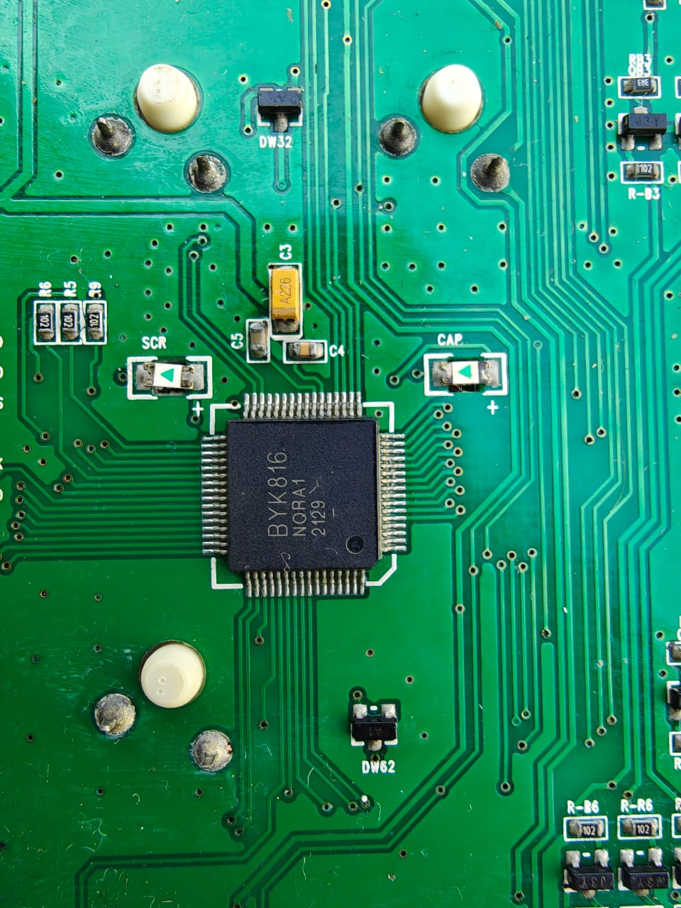
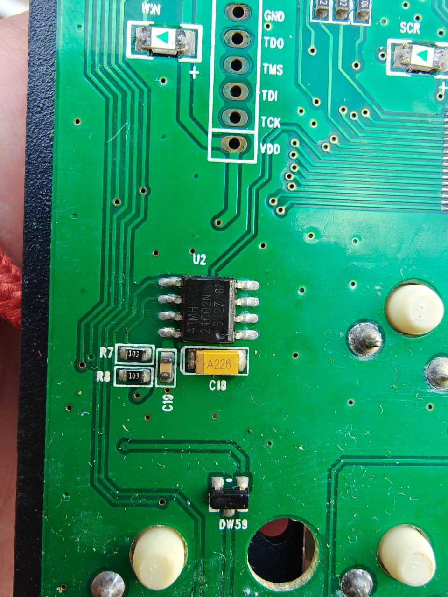
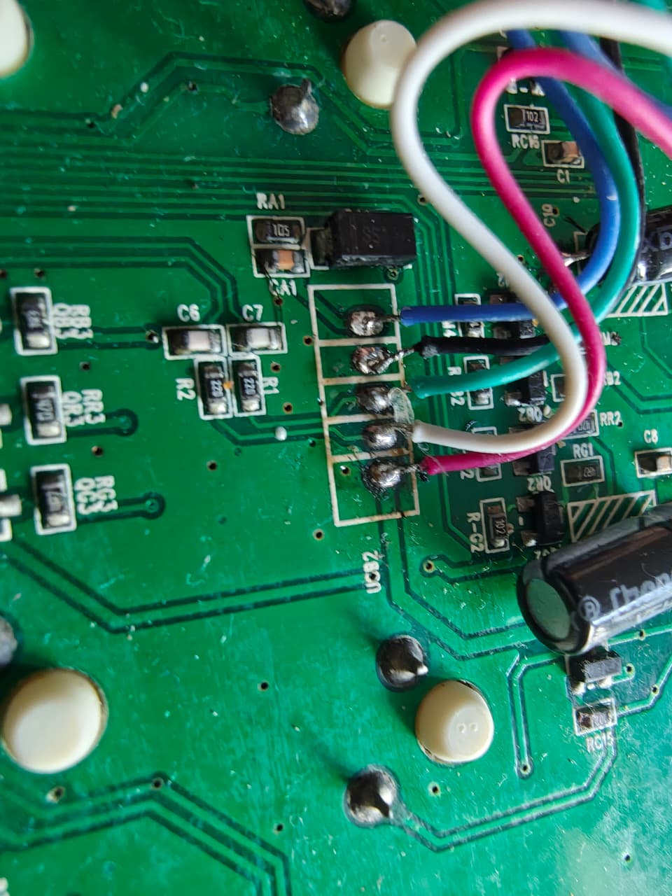
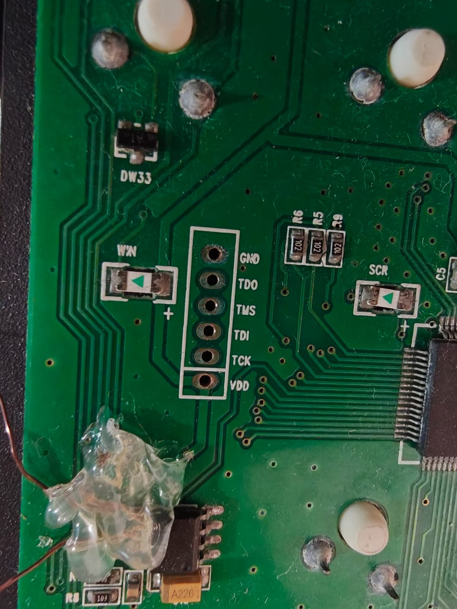
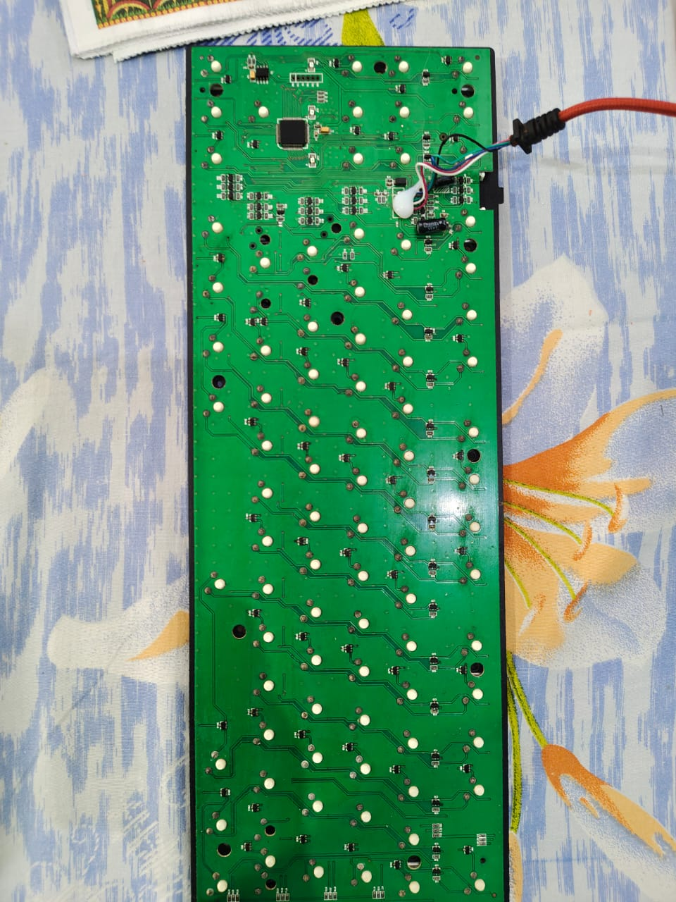

# EvoFox Katana Pro (SMK01) - bricked keyboard recovery and per-key RGB

How a bricked **EvoFox Katana Pro** (SinoWealth **SH68F89 / BYK816** MCU, a CIY X77 twin) was
brought back to life without the vendor software, using an **ESP32 as an ICP programmer**, and
then flashed with the open-source [SMK](https://github.com/karstx/smk) firmware.

**Outcome:** the keyboard enumerates again as `258A:0016` and the backlight works. Typing and every
RGB effect were not exhaustively tested.



## Contents

1. [Hardware](#hardware)
2. [How it got bricked](#how-it-got-bricked)
3. [Recovery, step by step](#recovery-step-by-step)
4. [What the flash dump showed](#what-the-flash-dump-showed)
5. [Wiring and tool usage](#wiring-and-tool-usage)
6. [Dumps and files](#dumps-and-files)
7. [Reflashing and customising](#reflashing-and-customising)
8. [Original HID RGB protocol (stock firmware)](#original-hid-rgb-protocol-stock-firmware)
9. [Lessons and gotchas](#lessons-and-gotchas)
10. [Credits](#credits)

## Hardware

| Part | Notes |
|---|---|
| MCU | SinoWealth **BYK816 = SH68F89**, 64-pin LQFP, 64 KB flash, JTAG ID `0x6161` |
| U2 | **24C02N** I2C EEPROM (settings store) |
| Header | unpopulated 6-pad JTAG/ICP header: GND, TDO, TMS, TDI, TCK, VDD |
| USB | cable soldered to a 5-pad header (UCB2) |
| USB IDs | stock `258A:0016`; ISP bootloader `0603:1021` |

| | |
|---|---|
|  |  |
| BYK816 MCU (date code 2129) | JTAG/ICP header (GND, TDO, TMS, TDI, TCK, VDD) and EEPROM U2 (24C02N) |
|  |  |
| USB cable soldered to the 5-pad UCB2 header | JTAG header, with glue and fine wires on the EEPROM (U2) |



## How it got bricked

An earlier session reverse-engineered the stock HID protocol (see
[the protocol section](#original-hid-rgb-protocol-stock-firmware)) and sent a test write to the config
tables with the wrong header: the data buffer went to address `00 00 00 00` (the modes table) with
unrelated content. The firmware hung and the keyboard stopped enumerating. This is the same failure
mode that made OpenRGB disable all SinoWealth keyboard detectors.

The 24C02 EEPROM was then dumped with an ESP32 (`katana-rgb/eeprom_dump/`). Bytes `0x00-0x87` were
identical to the known-good backup and the rest was `FF` (never written), so **the EEPROM was fine** and
the damage was in the MCU's own flash.

## Recovery, step by step

1. **ICP link.** An ESP32 (`icp_dumper/icp_dumper.ino`) speaks the SinoWealth ICP protocol, ported from
   gashtaan's dumper and carlossless/sinodude. The target is powered directly from a GPIO (no MOSFET needed;
   VDD to GPIO23 at max drive strength, the keyboard USB unplugged). `t` returned "ICP link OK".
2. **Backup.** The full 64 KB flash was dumped twice and the two dumps were byte-identical
   (`dumps/icp_flash/flash_dump.bin`, `flash_dump2.bin`).
3. **Diagnosis.** See [below](#what-the-flash-dump-showed): reset and interrupt vectors blank, most of the
   application area erased, bootloader intact.
4. **Reset vector.** Programming bytes at `0x0000` had no effect until **sector 0 was erased** first
   (erase status `00` = success). Then `02 F0 00` (`LJMP 0xF000`, the ISP bootloader) was written. The
   keyboard still did not enumerate, because the application it would jump to was gone.
5. **Force ISP mode.** The stock bootloader at `0xF000` jumps to the app only when byte `0xEFFB` is `02`
   (an `LJMP`). Changing `0xEFFB` from `02` to `03` made it stay in ISP mode, and the keyboard enumerated
   as `0603:1021`.
6. **ISP check.** `sinowisp read` read 61,440 bytes over USB, so the bootloader link works.
7. **SMK firmware.** Built SMK for `ciy-x77` (SDCC + meson + gcc) and wrote it with `sinowisp`
   (`firmware/ciy-x77_default_smk.hex`). After unplug and replug, the keyboard enumerated as
   `258A:0016` and the backlight came on.

## What the flash dump showed

- `0x0000-0x0107` read `FF`, so the reset vector and the interrupt vectors were blank. USB needs interrupts,
  so no USB.
- Large 4 KB blocks of the application area read `00`. **On this chip erased flash reads `00`**, so the
  firmware had been wiped. Sector 0 held noise beyond `0x0108`.
- The ISP bootloader at `0xF000` was intact. It starts `C2 AF 75 81 70 53 86 3F`. It reads `0xEFFB`
  and, if it is `02`, jumps into the application. `0xEFFB` held `02 86 58` (`LJMP 0x8658`).
- `0x8658` is a valid 8051 startup routine (clear IRAM, set SP, `LJMP main`). Only the vectors and
  most of the app were missing.
- Real code was visible at `0x3000`, `0x7000` and `0xC000`, with LED tables at `0x0800` and `0x8000`.
- sinowisp moves the application's reset vector to `0xEFFB` and puts `LJMP 0xF000` at `0x0000`, so after a
  normal ISP flash the bootloader always runs first and hands off to the app.
- Part definition (sinodude, SH68F89): chip type `0x02`, 65,536 bytes, 1 KB sectors, JTAG ID `0x6161`,
  3.3 V and 5 V supported.

## Wiring and tool usage

| Keyboard pad | ESP32 |
|---|---|
| GND | GND |
| TMS | GPIO18 |
| TCK | GPIO19 |
| TDI | GPIO21 |
| TDO | GPIO22 (input) |
| VDD | GPIO23 (powers the target at 3.3 V) |

**Rules:** the keyboard USB must be unplugged while the ESP32 is attached (the 5 V seen on VDD is only
from USB), and all ESP32 wires must be removed before plugging USB back in. Measure VDD to GND
resistance first (above about 150 ohm).

`icp_dumper/icp_dumper.ino` (115200 baud, one character per command):

| Cmd | Action |
|---|---|
| `t` | connection test |
| `i` | read JTAG ID |
| `r` | dump flash (aborts if address 0 reads blank) |
| `f` | forced dump |
| `p` | erase sector 0 and write the reset vector `02 F0 00` |
| `e` | change `0xEFFB` from `02` to `03` (force ISP mode) |

`python -u icp_dumper/capture.py COM6 out.bin [cmd]` saves a dump as a binary file (default command `r`).
Dumps print `AAAA:` plus 32 hex chars per line and end with `DUMP-END`.

ICP write sequence (chip type 2): select program space `46 F0 FF`, set offset with `40`/`41`, `42 <byte0>`,
`6E 15 0A 09 06 <byte1>`, then per byte exchange data and check the echo is the byte two positions back,
and finish with `00 AA`. Sector erase: `46 F0 FF`, offset, `42 00`, opcode `E6`, `15 0A 09 06 FF`, wait
150 ms, read the status byte (`00` = success).

**ESP32 quirks:** auto-reset into download mode is unreliable. Use esptool directly and hold BOOT, tap EN,
and keep holding BOOT during connect:
`esptool --chip esp32 --port COM6 --baud 460800 --connect-attempts 100 write-flash 0x10000 <sketch>.bin`.
The first `p` or `e` run can print nothing but still apply; run it again to read the result.

## Dumps and files

| File | Contents |
|---|---|
| `dumps/icp_flash/flash_dump.bin`, `flash_dump2.bin` | original bricked flash, byte-identical. **Keep: the only copy of the original state.** |
| `dumps/icp_flash/flash_dump3.bin` | after the sector 0 erase and reset-vector patch |
| `dumps/isp_readback/isp_read_after_isp_force.bin` | 61,440-byte ISP read after the `0xEFFB` change |
| `dumps/isp_readback/isp_read_after_smk_flash.bin` | ISP read after flashing SMK |
| `firmware/ciy-x77_default_smk.hex` | SMK firmware for the CIY X77 (ANSI 87-key), as flashed |
| `icp_dumper/` | ESP32 ICP sketch and capture script |
| `katana-rgb/` | HID protocol scripts, config table backups and EEPROM dumps from the stock firmware |

## Reflashing and customising

```
sinowisp write -f -d ciy-x77 firmware/ciy-x77_default_smk.hex
```

If the keyboard is already in ISP mode (`0603:1021`) add
`--vendor_id 0x0603 --product_id 0x1021 --isp_iface_num 0 --isp_report_id 5`.
sinowisp warns that the image is smaller than 61,440 bytes and zero-fills it; `-f` skips the confirmation.

SMK's X77 layout is ANSI 87-key. Backlight keys: `Fn`+`F9` next animation, `Fn`+`1`-`5` pick one
(`5` = off), `Fn`+`PgUp`/`PgDn` brightness, `Fn`+`-`/`=` speed, `Fn`+`Up`/`Down` colour. Settings are stored on
the 24C02 EEPROM.

Rebuilding SMK on Windows: install SDCC (`winget install SDCC.SDCC`), meson, ninja and a native gcc
(`BrechtSanders.WinLibs.POSIX.UCRT`), put `sinowisp` on PATH, then in a clone of karstx/smk run
`meson setup build` and `meson compile -C build ciy-x77_default_smk.hex`. Keyboard sources are in
`src/keyboards/ciy-x77`.

If the keyboard ever stops enumerating again, the ESP32 route above works: dump first, then repair.

## Original HID RGB protocol (stock firmware)

Valid only for the stock firmware, which is now replaced by SMK. Device: USB `258A:0016`, a composite HID
device. MI_00 is the keyboard; MI_01 has 7 collections (system control, consumer control, keyboard, mouse
and three vendor-defined collections, usage page `0xFF00`). It matches the family OpenRGB implements as
`SinowealthKeyboard16Controller` and responds to that protocol.

| collection | feature report size | role |
|---|---|---|
| MI_01 `col05` | 6 bytes | commands/requests (report ID `0x05`) |
| MI_01 `col06` | 1032 bytes | config data (report ID `0x06`) |
| MI_01 `col03` | none | unused |

Handshake after power-up (to `col05`): `05 01 AA BB 2F 3E`.

Reading a table: send the request to `col05`, then read feature report `0x06` (1032 bytes) from `col06`.

| table | request bytes | write address (`bytes[2..5]`) |
|---|---|---|
| modes / config | `05 83 00 00 00 00` | `00 00 00 00` |
| effect colours | `05 88 A8 00 40 00` | `A8 00 40 00` |
| per-key CM1+CM2 | `05 89 AC 00 40 00` | `AC 00 40 00` |
| per-key CM3+CM4 | `05 89 B0 00 40 00` | `B0 00 40 00` |
| per-key CM5 | `05 89 B4 00 40 00` | `B4 00 40 00` |

Writing a table: a 1032-byte feature report to `col06` with `byte0 = 0x06`, `byte1 = request_byte1 & 0x7F`
(clears the `0x80` request flag) and `byte2..5 =` the write address above. A buffer whose byte1 still has
bit 7 set is treated as a read and silently ignored. Writing a data buffer to the wrong address (for example
the modes table with unrelated content) hangs the firmware at next boot. **Always read a table before writing
it, and never write an address you did not read.**

Modes table (offset in the 1032-byte payload): `20` per-key mode flag, `21` current mode (`0-14` effects,
`0x0F` custom), `22` `0x20 | preset`, `32` 15 x 2-byte effect configs (`color:3 | :4 | dir:1`,
`brightness:4 | speed:4`). To show per-key colours set `[20]=1`, `[21]=0x0F`, `[22]=0x20|preset`, write it,
then write the per-key table.

Per-key table (132 LED slots): blue at `8+i`, green at `8+132+i`, red at `8+264+i`; CM2/CM4 are at `+396`.
Slot indices are the keyboard's internal LED order, not key order. Streaming full frames measured about
92 fps. Scripts in `katana-rgb/`: `hidwin.py` (dependency-free Windows HID layer), `probe.py` (read-only
probe), `analyze.py`, `demo.py`, `verify.py`, `restore_config.py`, `monitor_usb.py`, `monitor_fast.py`.
`backup/*.bin` are the five config tables saved before any write.

## Lessons and gotchas

- Dump first. A byte-identical double dump is the backup that makes every later step safe.
- On SH68F89 erased flash reads `00`, and programming does nothing until the sector is erased.
- Do not trust the ICP acknowledgement lines; verify by reading back.
- The bootloader's hand-off byte `0xEFFB` doubles as a way to force ISP mode.
- The ESP32 GPIO can power the target for dump and write, but USB and the ESP32 must never be connected
  to the keyboard at the same time.

## Credits

[gashtaan/sinowealth-8051-dumper](https://github.com/gashtaan/sinowealth-8051-dumper),
[karstx/sinodude](https://github.com/karstx/sinodude) and
[karstx/sinowisp](https://github.com/karstx/sinowisp),
[karstx/smk](https://github.com/karstx/smk).
